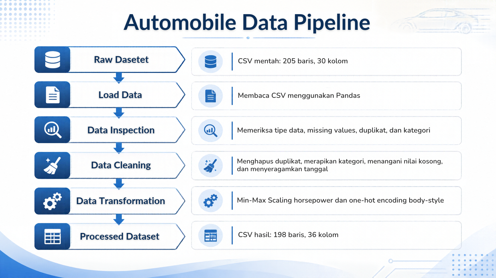

# Automobile Data Preparation Pipeline

Proyek assignment individu AI Engineering Bootcamp ReWork oleh Anton Wijaya

Proyek ini membangun pipeline ETL menggunakan Python untuk membaca dataset otomotif, memeriksa kualitas data, melakukan cleaning dan transformasi, lalu menyimpan hasil CSV baru.

## Dataset dan Sumber

Dataset berasal dari paket `Dataset_Sesi_3.zip` yand disediakan mentor ReWork Academy.

File input utama:
`data/raw/automobileEDA_dirty_training.csv`

Dataset memuat informasi kendaraan seperti merek, tipe bodi, spesifikasi mesin, kondisi bahan bakar, harga, dan tanggal transaksi.

File `automobileEDA.csv` dan `automobile_processed.csv` dari mentor hanya digunakan sebagai referensi. Hasil proyek harus dihasilkan melalui srcipt sendiri.

## Struktur Project

- `data/raw/` : dataset mentah.
- `data/processed/`: dataset hasil pipeline.
- `src/pipeline.py`: script pipeline.
- `documentation/`: diagram alur data.
- `requirements.txt`: daftar dependency.
- `README.md` : dokumentasi proyek.

## Kondisi Awal Dataset

Pemeriksaan awal dilakukan melalui `pipeline.py` dan ditampilkan di terminal.

- Jumlah baris: 205
- Jumlah kolom : 30
- Jumlah baris duplikat persis: 4
- Total missing values: 17 sel pada 7 kolom

## Missing Values

| Kolom | Jumlah nilai kosong |
| ---|---:|
| transaction_date | 2 |
| make | 2 |
| num-of-doors | 2 |
| stroke | 4 |
| horsepower | 3 |
| price | 3 |
| horsepower-binned | 1 |
| **Total** | **17** |

### Permasalahan yang Ditemukan

1. Terdapat 4 baris duplikat persis.
2. Beberapa kolom memiliki nilai kosong.
3. Huruf besar dan kecil pada kategori belum konsisten seperti `audi` dan `Audi`, serta `sedan` dan `SEDAN`.
4. Terdapat spasi berlebih pada kategori seperti `dogde   ` dan `porsche   `.
5. Kolom `transaction_date` masih berupa teks dengan beberapa format tanggal.
6. Kolom `drive-wheels` memiliki label `AWD` dan `4WD` yang perlu ditinjau sebelum diputuskan apakah akan diseragamkan.

Contoh format tanggal yang ditemukan:
- `2025-01-01`
- `02/01/2025`
- `01-03-2025`
- `04-Jan-2025`

## Data Cleaning

### Tahap 1 - Duplikat dan Format Kategori

Proses yang dilakukan:
- Menghapus baris duplikat persis menggunakan `drop_duplicates()`.
- Menghapus spasi di awal dan akhir kategori menggunakan `str.strip()`.
- Menyeragamkan penulisan kategori menjadi huruf kecil menggunakan `str.lower()`.

Kolom yang mengalamai perubahan kategori:
`make`, `body-style`, `drive-wheels`, `fuel-system`, dan `horsepower-binned`.

Penghapusan duplikat dilakukan agar data yang sama tidak dihitung berulang. Perapian kategori dilakukan agar perbedaan huruf dan spasi tidak dianggap sebagai kategori berbeda.

Hasil cleaning tahap 1:
- Jumlah baris sebelum: 205.
- Jumlah duplikat yang dihapus: 4.
- Jumlah baris sesudah: 201.
- Missing values sebelum: 17.
- Missing values sesudah: 16.

Berkurang satu missing value terjadi karena nilai kosong tersebut berada pada baris duplikat yang dihapus. Belum dilakukan pengisian missing values atau perbaikan format tanggal.

Dataset mentah tidak diubah

### Tahap 2 - Penanganan Missing Values

- Menghapus 3 baris dengan `price` kosong karena analisis/prediksi harga membutuhkan nilai harga asli
- Mengisi `stroke` dan `horsepower` yang kosong dengan median masing-masing kolom. Median dipilih karena lebih tahan terhadap nilai ekstrem dibandingkan rata-rata.
- Mengisi `num-of-doors` yang kosong dengan modus, yaitu `four`.
- Mengisi `make` dan `horsepower-binned` yang kosong dengan `unknown` agar informasi yang tidak diketahui tidak ditebak.

Hasil Cleaning tahap 2:
- Jumlah baris sebelum: 201.
- Jumlah baris sesudah: 198.
- Missing values sebelum: 16.
- Missing values sesudah: 2.

Dua nilai kosong yang tersisa berada pada kolom `transaction_date` dan belum ditangani pada tahap ini.

### Tahap 3 - Penyeragaman Tanggal

Kolom `transaction_date` diubah dari teks menjadi tipe datetime.

Aturan pembacaan format:

- `YYYY-MM-DD` : tahun-bulan-hari.
- `DD/MM/YYYY`: hari/bulan/tahun.
- `MM-DD-YYYY`: bulan-hari-tahun.
- `DD-Mon-YYYY`: hari-nama bulan-tahun.

Format angka bertanda hubung dibaca sebagai bulan-hari-tahun berdasarkan pola dataset, termasuk nilai seperti `01-15-2025`.

Contoh hasil

| Sebelum | Sesudah |
|---|---|
| 2025-01-01 | 2025-01-01 |
| 02/01/2025 | 2025-01-02 |
| 01-03-2025 | 2025-01-03 |
| 04-Jan-2025 | 2025-01-04 |

Dua tanggal kosong dipertahankan sebagai `NaT` karena tanggal aslinya tidak diketahui. Mengisi dengan tanggal perkiriaan dapat menghasilkan informasi yang keliru.

Hasil tahap ini:
- Tipe tanggal: `datetime64[us]`.
- Tanggal kosong: 2.
- Jumlah baris: 198.
- Jumlah kolom: 30.

## Data Transfomation

### Min-Max Scaling

Kolom `horsepower` dinoemalisasi menjadi skala 0-1 menggunakan:

(nilai - minimum) / (maksimum - minimum)

Nilai minimum adalah 48 dan maksimum adalah 262.
Hasil disimpan pada kolom baru `horsepower_scaled`.

kolom ini dipilih karena tenaga mesin merupakan fitur numerik yang relevan untuk analisis kendaraan. Kolom asli dipertahankan agar hasil dapat dibandingkan.

| Horsepower asli | Horsepower scaled |
|---:|---:|
| 111 | 0.294393 |
| 154 | 0.495327 |
| 102 | 0.252336 |
| 115 | 0.313084 |

### One-Hot Encoding

Kolom `body-style` dipilih karena berisi kategori tipe bodi tanpa urutan tingkatan. One-hot encoding mengubahnya menjadi indikator angka tanpa memberikan peringkat pada kategori.

Lima kolom baru yang dihasilkan:
- `body_convertible`
- `body_hardtop`
- `body_hatchback`
- `body_sedan`
- `body_wagon`

Nilai 1 menunjukan kendaran termasuk kategori tersebut, sedangkan 0 menunjukkan bukan kategori tersebut. Kolom asli `body-style` tetap dipertahankan.

| Tipe bodi asli | convertible | hardtop | hatchback | sedan | wagon |
|---|---:|---:|---:|---:|---:|
| convertible | 1 | 0 | 0 | 0 | 0 |
| hatchback | 0 | 0 | 1 | 0 | 0 |
| sedan | 0 | 0 | 0 | 1 | 0 |

Jumlah data setelah transformasi adalah 198 baris dan 36 kolom.

## Ringkasan Hasil

| Tahap | Jumlah Baris | Jumlah Kolom |
|---|---:|---:|
| Dataset mentah | 205 | 30 |
| Setelah cleaning tahap 1 | 201 | 30 |
| Setelah cleaning tahap 2 | 198 | 30 |
| Setelah cleaning tahap 3 | 198 | 30 |
| Setelah transformasi | 198 | 36 |
| CSV hasil tersimpan | 198 | 36 |

## Verifikasi Output

CSV hasil dibaca kembali menggunakan Pandas untuk memeriksa:
- Ukuran dataset : 198 baris dan 36 kolom.
- Jumlah baris duplikat: 0.
- Missing values hanya tersisa pada `transaction_date`: 2.
- Rentang `horsepower_scaled`: 0-1.
- Seluruh kolom one-hot encoding hanya berisi 0 atau 1.
- Setiap baris memiliki tepat satu indikator tipe bodi bernilai 1.

## Instalasi Depedency

Jalankan melalui terminal PowerShell dari folder utama proyek. 

Buat virtual environment:

```powershell python -m venv .venv ```

Aktifkan environment:

```powershell .\.venv\Scripts\Activate.ps1 ```

Install depedency:

```powershell python -m pip install -r requirements.txt ```

## Menjalankan Pipeline

Dari folder utama proyek:

```powershell python .\src\pipeline.py```

Pipeline menjalankan seluruh proses dalam satu kali eksekusi:
membaca dataset mentah, menampilkan pemeriksaan awal, melakukan
cleaning dan transformasi, lalu menyimpan hasil sebagai CSV baru.

Saat berhasil, terminal menampilkan lokasi file hasil,
198 baris, 36 kolom, dan pesan `Pipeline selesai.`

## Alur ETL

1. **Extract:** `load_data()` membaca dataset mentah dari `data/raw/`.
2. **Transform:** `inspect_data()` memeriksa kondisi awal, `clean_data()` membersihkan data, dan `transform_data()` menambahkan Min-Max Scaling serta one-hot encoding.
3. **Load:** `save_data()` menyimpan hasil ke 'data/processed/'.

Seluruh function dipanggil secara berurutan melalui `main()`.

## Data Flow Diagram



## Lokasi Output

Data hasil pipeline tersimpan di:

`data/processed/automobileEDA_processed.csv`

File dihasilkan otomatis oleh function `save_data()`, dengan ketentuan:
- Berisi 198 baris dan 36 kolom.
- Nomor indeks DataFrame tidak disimpan sebagai kolom tambahan. 
- Tanggal disimpan dalam format `YYYY-MM-DD`.
Dua tanggal yang tidak diketahui disimpan sebagai nilai kosong.
Dataset mentah di `data/raw/` tidak ditimpa.

Menjalankan ulang pipeline akan memperbarui file processed berdasarkan dataset mentah dan aturan pengolahan yang sama.